# TP 11 – Authentification JDBC / JPA avec Spring Security

Ce TP remplace l'authentification en mémoire (`InMemoryUserDetailsManager`) par une authentification qui lit les utilisateurs et leurs rôles dans une base **MySQL**, via **Spring Data JPA**. Les mots de passe sont hachés avec **BCrypt**.

## Technologies

- Java 17+ et Spring Boot 3.5 (Spring Security 6)
- Spring Data JPA / Hibernate et MySQL
- Thymeleaf et Lombok

## Structure

```
src/main/java/ma/fstg/security
├── entities/          User, Role (relation @ManyToMany EAGER)
├── repositories/      UserRepository, RoleRepository
├── services/          CustomUserDetailsService (implémente UserDetailsService)
├── config/            SecurityConfig (BCrypt, DaoAuthenticationProvider, règles d'accès)
│                      DatabaseInitializer (crée admin/user au démarrage)
└── web/               AuthController (/login, /register), HomeController (/home, dashboards)
src/main/resources
├── application.properties
├── templates/         login, register, home, admin/dashboard, user/dashboard, error/403
└── static/css/        style.css
database/security_db.sql
docs/screenshots/      captures d'écran de l'application en fonctionnement
```

## Lancer le projet

1. Démarrer MySQL, par exemple via XAMPP ou WAMP, avec l'utilisateur `root` sans mot de passe. Si ton mot de passe est différent, modifie `spring.datasource.password` dans `application.properties`.
   Autre possibilité, avec Docker :
   ```bash
   docker run -d --name tp11-mysql -p 3306:3306 -e MYSQL_ALLOW_EMPTY_PASSWORD=yes mysql:8.4
   ```
2. Créer la base avec `database/security_db.sql`. L'URL JDBC contient aussi `createDatabaseIfNotExist=true`, donc la base est créée automatiquement si elle n'existe pas.
3. Lancer l'application :
   ```bash
   ./mvnw spring-boot:run        # Linux / macOS / Git Bash
   mvnw.cmd spring-boot:run      # Windows
   ```
4. Ouvrir http://localhost:8080/login

## Comptes de test

| Utilisateur | Mot de passe | Rôles                  | Accès                                 |
|-------------|--------------|------------------------|---------------------------------------|
| admin       | 1234         | ROLE_ADMIN, ROLE_USER  | `/admin/dashboard`, `/user/dashboard` |
| user        | 1111         | ROLE_USER              | `/user/dashboard` (403 sur `/admin/**`) |

Tu peux aussi créer un nouveau compte (avec le rôle `ROLE_USER`) depuis `/register`.

## Vérification dans MySQL

```sql
USE security_db;
SHOW TABLES;                 -- user, role, user_roles
SELECT username, password FROM user;   -- les mots de passe commencent par $2a$
```

## Captures d'écran

Ces captures ont été prises sur l'application lancée avec `mvnw spring-boot:run`, connectée à un serveur **MySQL 8.4**.

### 1. Démarrage : Hibernate crée les tables et `DatabaseInitializer` insère les données

Grâce à `ddl-auto=update`, Hibernate génère les tables `role`, `user` et la table de jointure `user_roles` à partir des entités JPA. `show-sql=true` affiche les requêtes dans la console.

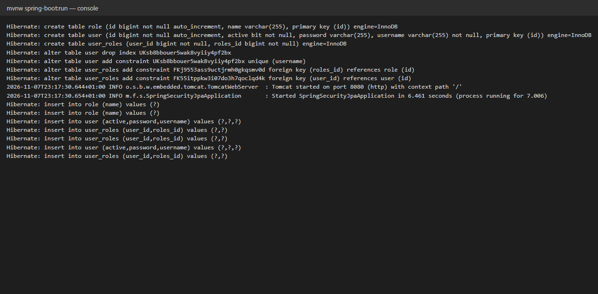

### 2. Page de connexion

Si on demande `/home` sans être connecté, on est redirigé vers la page de login personnalisée (`/login`).

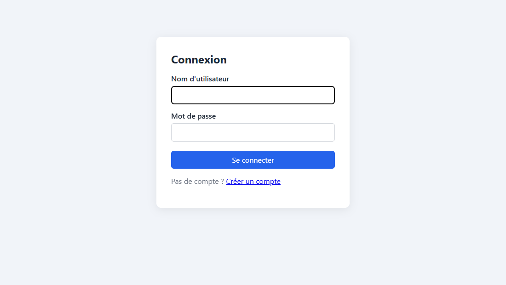

### 3. Mauvais identifiants

`failureUrl("/login?error=true")` renvoie sur le login avec un message d'erreur.

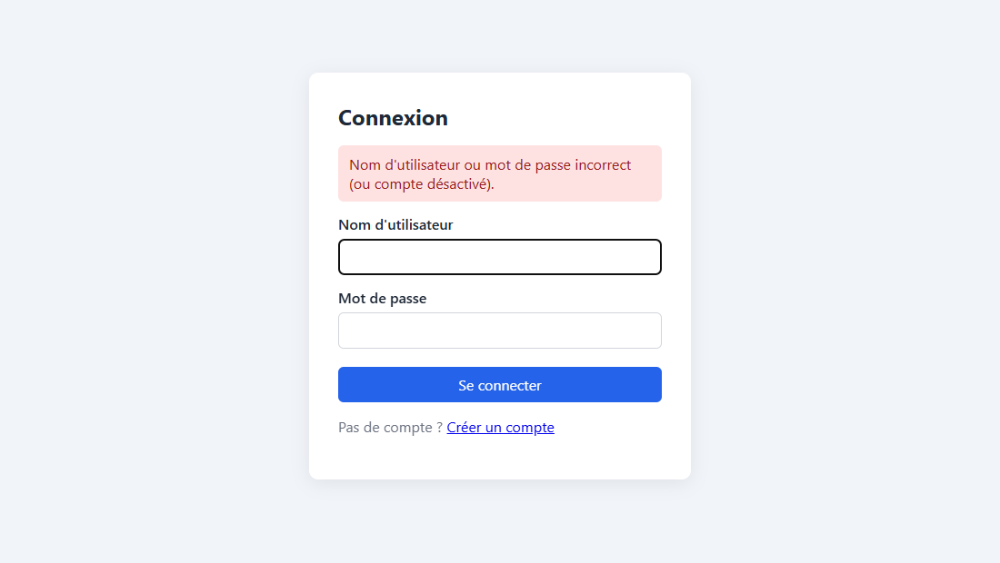

### 4. Connexion `admin / 1234`

Après la connexion, `defaultSuccessUrl("/home", true)` redirige vers l'accueil. Les rôles `ROLE_ADMIN` et `ROLE_USER` sont chargés depuis MySQL par `CustomUserDetailsService`.

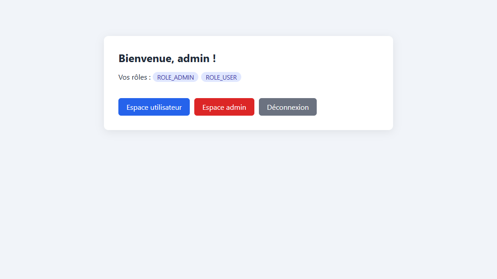

L'administrateur a accès à `/admin/dashboard` :

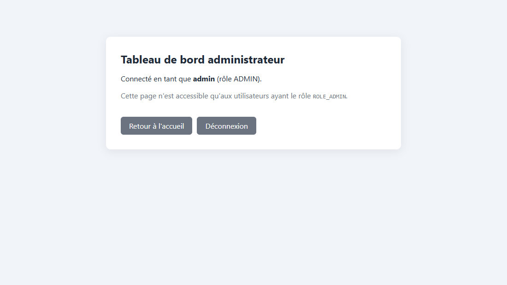

### 5. Connexion `user / 1111`

L'utilisateur n'a que `ROLE_USER`, donc le bouton « Espace admin » n'est pas affiché :

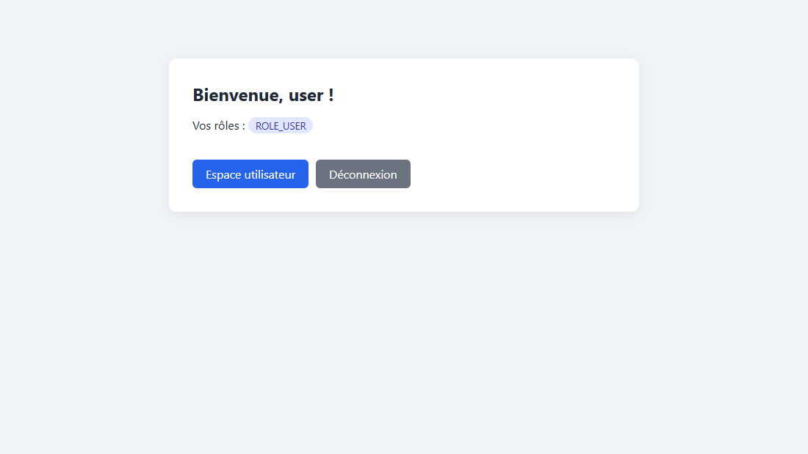

Il a accès à `/user/dashboard` :

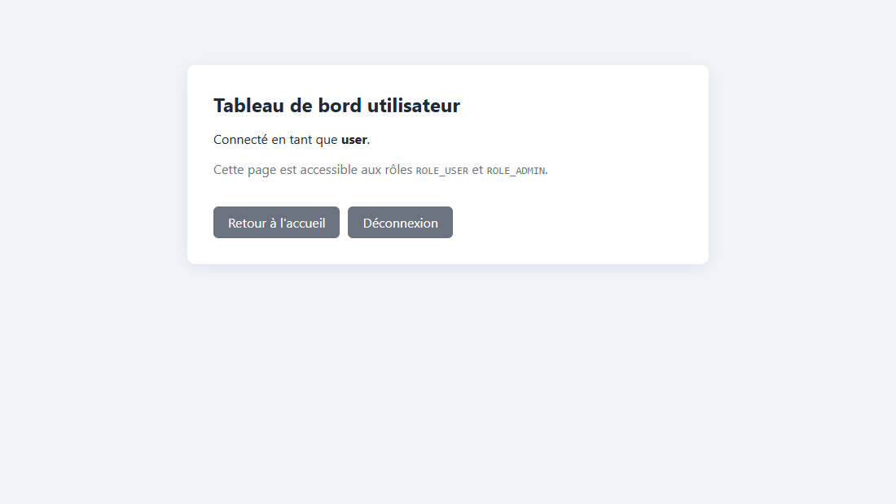

En revanche, `/admin/dashboard` lui est refusé (**403 Forbidden**) par `.requestMatchers("/admin/**").hasRole("ADMIN")` :

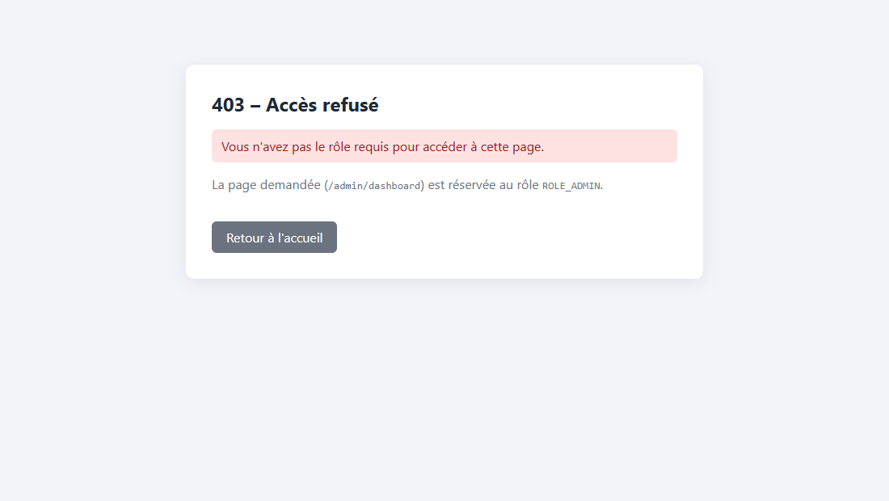

### 6. Déconnexion

`logoutSuccessUrl("/login?logout=true")` :

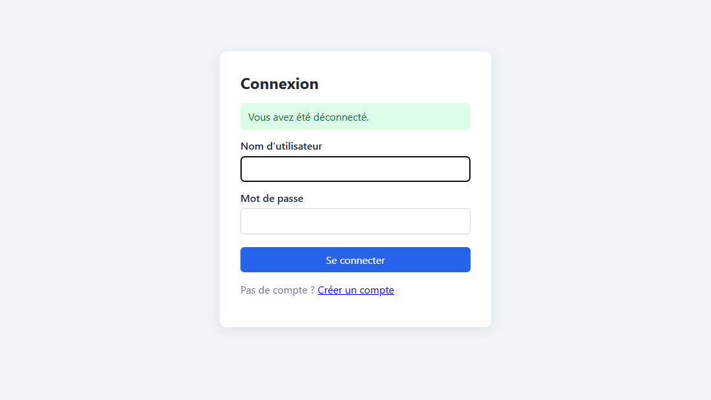

### 7. Inscription d'un nouvel utilisateur

Le mot de passe est haché avec BCrypt avant d'être enregistré, et le compte reçoit le rôle `ROLE_USER` :

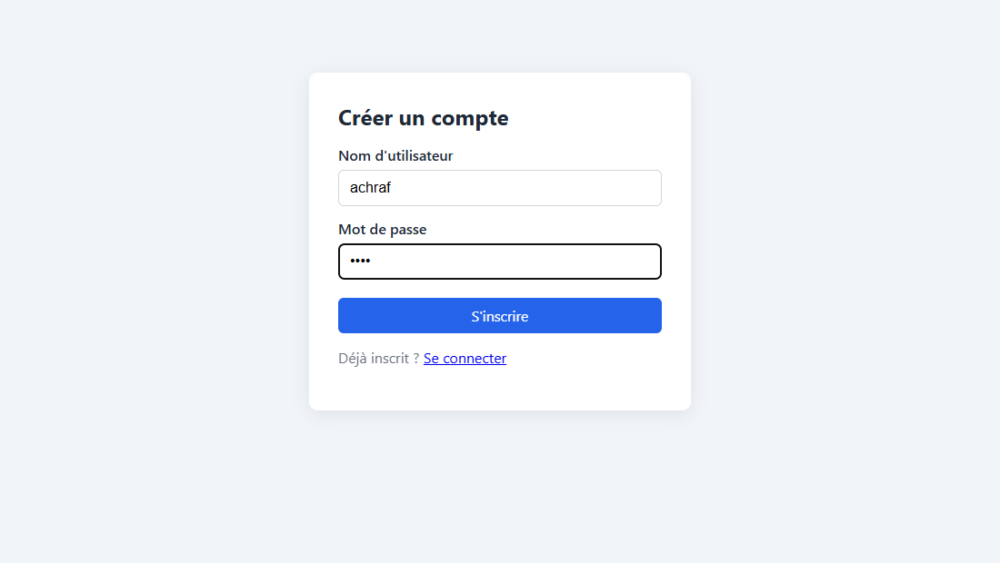


### 8. Vérification dans MySQL (étape 8)

On retrouve les tables `user`, `role` et `user_roles`. Les mots de passe sont stockés hachés avec BCrypt (préfixe `$2a$10$`) et jamais en clair :

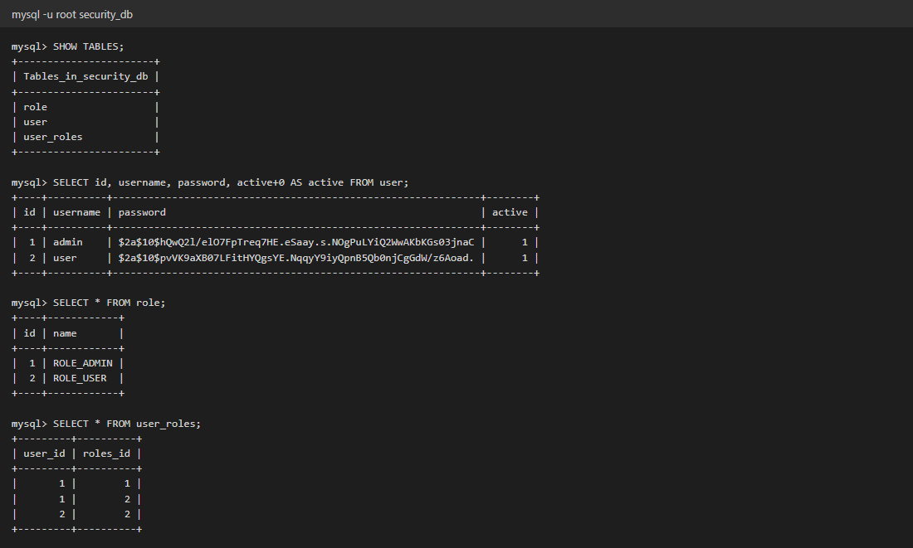

## Notes

- `DatabaseInitializer` ne crée les rôles et les utilisateurs que s'ils n'existent pas encore. Avec `ddl-auto=update`, les données sont conservées d'un démarrage à l'autre. Sans cette vérification, chaque redémarrage créerait des doublons et `findByUsername` échouerait.
- `DaoAuthenticationProvider` reçoit le `UserDetailsService` dans son constructeur. C'est la forme recommandée depuis Spring Security 6.3, car le constructeur vide et `setUserDetailsService()` sont dépréciés.
